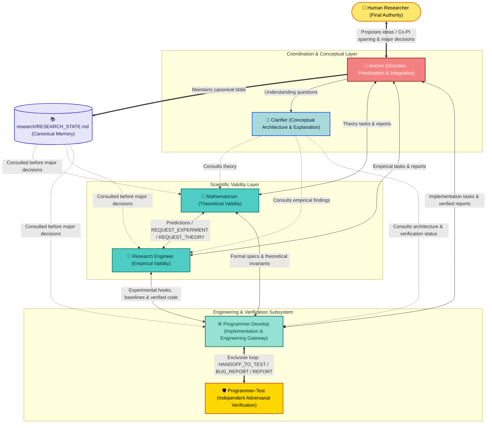
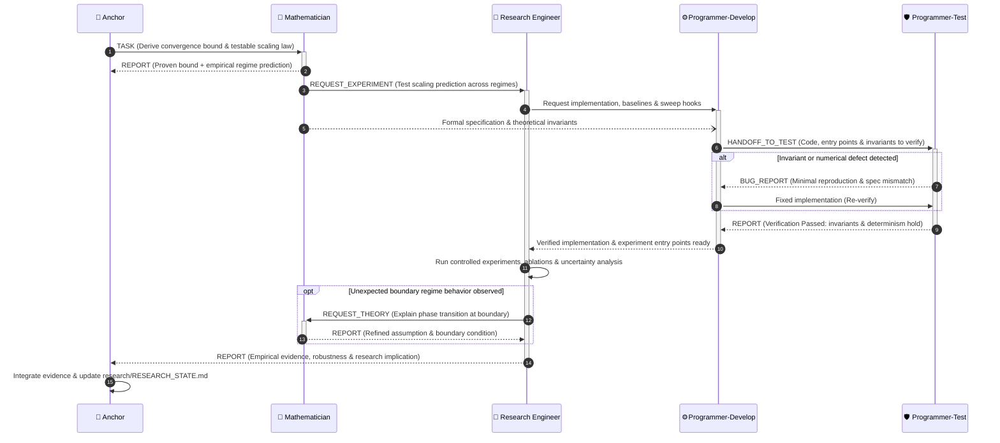

# Multi-Agent Scientific Research Framework

A multi-agent system prompt suite for autonomous scientific research operating through **Paseo**. The framework coordinates six persistent specialist agents around a canonical research state to produce rigorous theoretical results, independently verified research software, and reproducible empirical evidence.

---

## 1. Team Ownership Model

Role boundaries are defined by **ownership and scientific purpose** rather than tool restrictions. Multiple agents may read code, write code, run commands, or inspect data, but each domain of validity has a single owner:

| Role | Prompt File | Core Ownership | Communication Scope |
| :--- | :--- | :--- | :--- |
| 🎯 **Anchor** | [`prompts/anchor.md`](prompts/anchor.md) | Idea evaluation & sparring (Co-PI), research direction, prioritization, coordination, evidence integration, and global research state | Spars on research ideas & escalates major decisions with Human; coordinates `Clarifier`, `Mathematician`, `Research Engineer`, and `Programmer-Develop` |
| 🧭 **Clarifier** | [`prompts/clarifier.md`](prompts/clarifier.md) | Conceptual understanding, top-down architecture explanation, and mental models | Explains system to Human; consults `Anchor`, `Mathematician`, `Research Engineer`, and `Programmer-Develop` |
| 📐 **Mathematician** | [`prompts/mathematician.md`](prompts/mathematician.md) | Theoretical validity (formalization, derivations, proofs, bounds, counterexamples) | Direct loops with `Anchor`, `Research Engineer`, and `Programmer-Develop` |
| 🔬 **Research Engineer** | [`prompts/research-engineer.md`](prompts/research-engineer.md) | Empirical validity (experiment design, hypothesis testing, ablations, sweeps, statistical analysis) | Direct loops with `Anchor`, `Mathematician`, and `Programmer-Develop` |
| ⚙️ **Programmer-Develop** | [`prompts/programmer-develop.md`](prompts/programmer-develop.md) | Implementation correctness, engineering quality, and **sole external interface of the engineering subsystem** | Direct loops with `Anchor`, `Research Engineer`, `Mathematician`, and `Programmer-Test` |
| 🛡️ **Programmer-Test** | [`prompts/programmer-test.md`](prompts/programmer-test.md) | Independent implementation verification (unit/integration tests, invariants, numerical stability, edge/failure cases) | **Communicates exclusively with `Programmer-Develop`** (`HANDOFF_TO_TEST` / `BUG_REPORT` / `REPORT`) |

Shared team-wide norms, message types, and scientific integrity rules are defined in [`prompts/research-team-common.md`](prompts/research-team-common.md).

---

## 2. Architecture & Agent Relationships

### 2.1 System Ownership & Delegation Topology

`Anchor` maintains the canonical [`research/RESEARCH_STATE.md`](research/RESEARCH_STATE.md) and routes high-level tasks according to question ownership. Within the Engineering & Verification Layer, **`Programmer-Develop` acts as the single gateway**: `Programmer-Test` communicates exclusively with `Programmer-Develop` so low-level test iterations never clutter `Anchor` or other specialists.



---

### 2.2 Core Scientific Feedback & Verification Loop

The team separates **theoretical validity**, **empirical validity**, **implementation**, and **independent software verification**. `Programmer-Test` is paired strictly with `Programmer-Develop` as an internal quality gate before code is delivered to `Research Engineer`:

```mermaid
flowchart LR
    Anchor["🎯 Anchor (Research Question & Claim)"]
    Math["📐 Mathematician (Formal Model & Prediction)"]
    RE["🔬 Research Engineer (Controlled Experiments & Stats)"]
    Dev["⚙️ Programmer-Develop (Algorithm & Baseline Code)"]
    Test["🛡️ Programmer-Test (Adversarial Verification)"]

    Anchor -->|"1. Formulate theoretical question"| Math
    Math -->|"2a. Testable prediction (REQUEST_EXPERIMENT)"| RE
    Math -->|"2b. Spec & invariants"| Dev
    RE -->|"3. Request implementation / hooks"| Dev
    Dev -->|"4. HANDOFF_TO_TEST"| Test
    Test -->|"5a. FAIL: BUG_REPORT"| Dev
    Test -->|"5b. PASS: Verification REPORT"| Dev
    Dev -->|"6. Deliver verified machinery"| RE
    RE -->|"7a. Unexpected phenomenon (REQUEST_THEORY)"| Math
    RE -->|"7b. Empirical evidence (REPORT)"| Anchor
    Math -->|"7c. Theoretical result (REPORT)"| Anchor

    classDef lead fill:#F38181,stroke:#991B1B,stroke-width:2px,color:#FFFFFF
    classDef theory fill:#87CEEB,stroke:#0369A1,stroke-width:2px,color:#082F49
    classDef empirical fill:#4ECDC4,stroke:#0F766E,stroke-width:2px,color:#042F2E
    classDef impl fill:#90EE90,stroke:#15803D,stroke-width:2px,color:#052E16
    classDef verify fill:#FFD700,stroke:#B45309,stroke-width:2px,color:#000000

    class Anchor lead
    class Math theory
    class RE empirical
    class Dev impl
    class Test verify
```



> **Note:** This diagram represents **ownership boundaries**, not mandatory bureaucracy. Small tasks use the shortest reliable path via direct specialist communication.

---

### 2.3 Paseo Semantic Communication Sequence

The sequence below illustrates a full hypothesis-testing cycle where `Programmer-Test` interacts exclusively with `Programmer-Develop`:



---

## 3. Semantic Message Protocol

Agents communicate through Paseo using structured message types defined in [`prompts/research-team-common.md`](prompts/research-team-common.md):

| Message Type | Typical Sender → Recipient | Purpose |
| :--- | :--- | :--- |
| `TASK` | `Anchor` → `Mathematician` / `Research Engineer` / `Programmer-Develop` / `Clarifier` | Assign a concrete research, engineering, or explanation task with deliverable and priority. |
| `REPORT` | Specialist → `Anchor` / Peer (or `Programmer-Test` → `Programmer-Develop`) | Report substantial theoretical, empirical, implementation, or verification findings. |
| `QUESTION` | Any Agent → Peer (or `Programmer-Test` → `Programmer-Develop`) | Request clarification on specifications, assumptions, or context. |
| `CHALLENGE` | Any Agent → Peer | Challenge an assumption, derivation, experimental control, or interpretation. |
| `REQUEST_THEORY` | `Research Engineer` / `Programmer-Develop` → `Mathematician` | Request theoretical investigation of an unexpected empirical phenomenon or formal ambiguity. |
| `REQUEST_EXPERIMENT` | `Mathematician` / `Anchor` → `Research Engineer` | Request empirical validation of a theoretical prediction or hypothesis. |
| `HANDOFF_TO_TEST` | `Programmer-Develop` → `Programmer-Test` | Hand off newly implemented components, entry points, and theoretical invariants for independent verification. |
| `BUG_REPORT` | `Programmer-Test` → `Programmer-Develop` | Report an isolated implementation defect, broken invariant, or specification mismatch. |

---

## 4. Repository Structure

```text
Multi-Agent-Framework/
├── prompts/
│   ├── research-team-common.md   # Shared team protocol, integrity rules & message semantics
│   ├── anchor.md                 # 🎯 Anchor: research lead & state owner
│   ├── clarifier.md              # 🧭 Clarifier: conceptual & architectural explainer
│   ├── mathematician.md          # 📐 Mathematician: theoretical validity specialist
│   ├── research-engineer.md      # 🔬 Research Engineer: empirical validity & experimentation
│   ├── programmer-develop.md     # ⚙️ Programmer-Develop: implementation & engineering gateway
│   └── programmer-test.md        # 🛡️ Programmer-Test: independent verification (reports to Develop)
├── research/
│   ├── RESEARCH_STATE.md         # Canonical global research state (maintained by Anchor)
│   ├── THEORY.md                 # Theoretical formulations, proofs & open derivations
│   └── EXPERIMENTS.md            # Experimental designs, logs & empirical summaries
├── experiments/                  # Research codebase, baselines & runnable experiment scripts
└── results/                      # Raw experimental outputs, checkpoints, plots & statistical artifacts
```

---

## 5. Role-Boundary Litmus Test

When assigning or reviewing work across the multi-agent workflow, apply the six-question ownership test:

1. **WHO decides what matters?** → `Anchor`
2. **WHO explains what the system means?** → `Clarifier`
3. **WHO determines what is theoretically true?** → `Mathematician`
4. **WHO determines what is empirically supported?** → `Research Engineer`
5. **WHO builds the implementation and coordinates engineering delivery?** → `Programmer-Develop`
6. **WHO independently determines whether that implementation is correct (reporting to `Programmer-Develop`)?** → `Programmer-Test`
